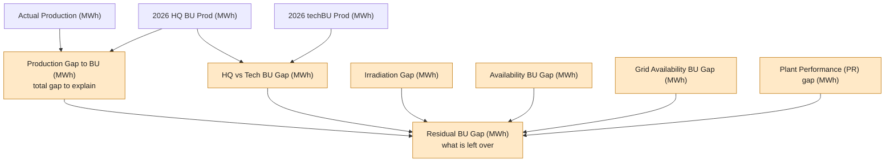
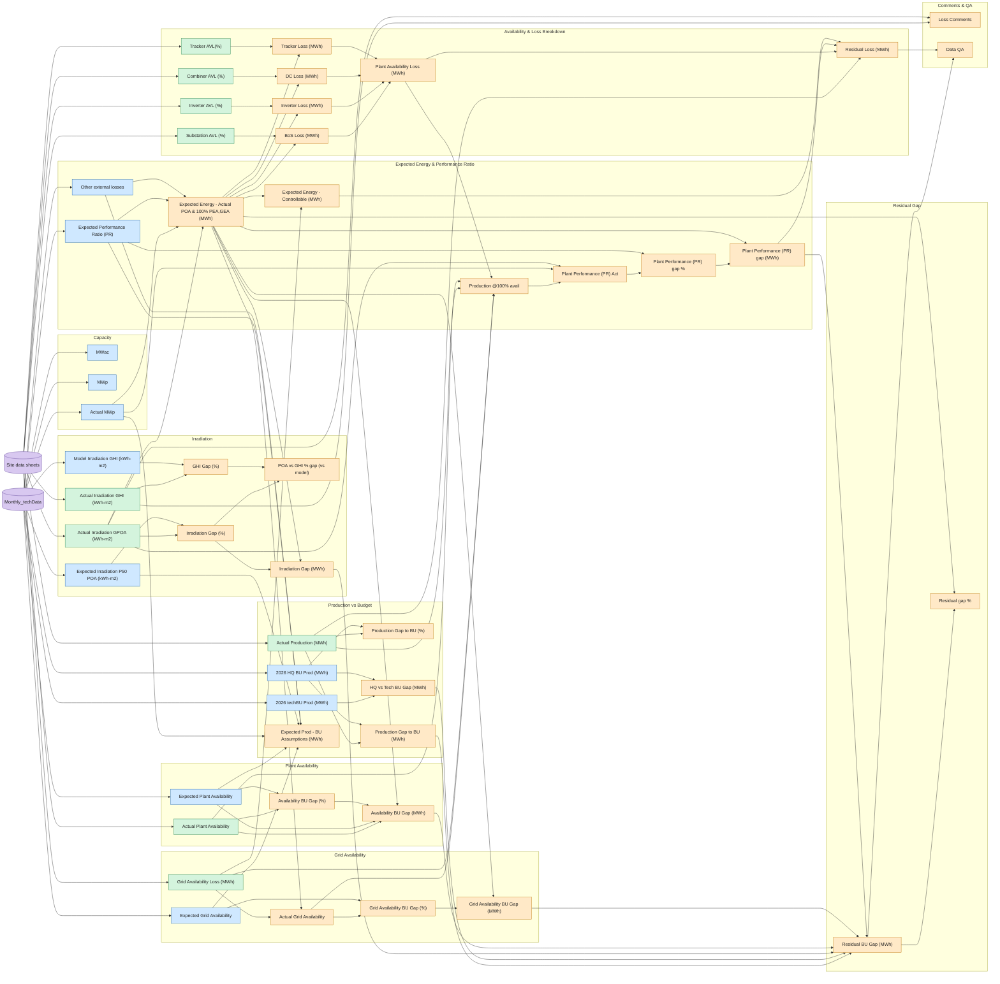

# Flow Diagrams

## 1. The gap bridge

How the budget gap is explained. Each arrow into the residual is a term in its formula.

## 2. Full dependency flow

Every calculation in the Daily sheet, generated from the actual formulas. Purple = source tables, blue = monthly lookups, green = site-data pulls, orange = calculations. Site Name, Date and Month feed every lookup and are left out to keep it readable.

If the big diagram is hard to read, use Obsidian's Graph view with the **Local graph** on a single formula or variable note, or zoom the diagram with Ctrl/Cmd + scroll.
